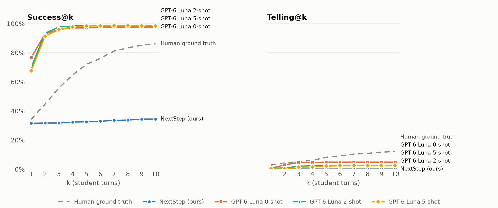
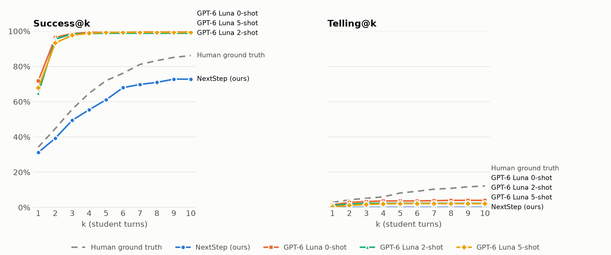

# Do Current LLM Tutors Still Give Away the Answer? Replicating MathDial with GPT-6 Luna

Individual LLM assignment for the Master's course *Core Topics in Artificial Intelligence* (Tilburg University, 2026).

This repository is a fork of the official [MathDial repository](https://github.com/eth-nlped/mathdial) by Macina et al. (2023). It replicates the paper's **interactive tutoring evaluation** with a current model: `gpt-6-luna` tutors a simulated student (`gpt-4.1-nano`) through multi-step maths word problems, and the dialogues are scored on how often the student reaches the answer (Success@k) and how often the tutor gives it away first (Telling@k). We compare zero-, two- and five-shot prompting of the tutor and repeat everything with a second, more stubborn simulated student.

- Original paper: [MathDial: A Dialogue Tutoring Dataset with Rich Pedagogical Properties Grounded in Math Reasoning Problems](https://arxiv.org/abs/2305.14536) (Findings of EMNLP 2023)
- Dataset: [Hugging Face Hub](https://huggingface.co/datasets/eth-nlped/mathdial)
- Upstream code: [eth-nlped/mathdial](https://github.com/eth-nlped/mathdial)

## Contents
- [Application and design](#application-and-design)
- [Main results](#main-results)
- [Repository structure](#repository-structure)
- [Setup](#setup)
- [Reproducing the experiments](#reproducing-the-experiments)
- [Method and changes to the original code](#method-and-changes-to-the-original-code)
- [Detailed results](#detailed-results)
- [Cost and runtime](#cost-and-runtime)
- [Limitations](#limitations)
- [Human-AI teaming and ethical considerations](#human-ai-teaming-and-ethical-considerations)
- [Original MathDial material](#original-mathdial-material)
- [Citation and license](#citation-and-license)

## Application and design

| Aspect | Choice |
|---|---|
| Domain | One-to-one tutoring of multi-step maths word problems (GSM8K problems, as in MathDial) |
| Agent | Non-embodied, text-based chatbot tutor |
| Modality | Written dialogue only |
| Intended users | Middle-school learners (MathDial's student personas show typical 7th-grade confusions); teachers as supervisors |
| Tutor model | `gpt-6-luna` with `reasoning_effort="none"`, via the Tilburg University OpenAI-compatible API |
| Simulated student | `gpt-4.1-nano`, temperature 0.4, prompted with MathDial's student persona |
| Prompting conditions | 0-shot (the paper's tutor prompt), 2-shot and 5-shot (good MathDial training dialogues added to the prompt) |
| Baseline | NextStep: a tutor that only ever asks "What is the next step?" |
| User scenarios | (1) the original student persona; (2) a calibrated, more stubborn persona |

**Why GPT-6 Luna?** The paper's models (`text-davinci-003`, `gpt-3.5-turbo-instruct`, `gpt-3.5-turbo`) are retired. GPT-6 Luna is OpenAI's low-cost model for high-volume tasks ($0.10 / $0.50 per million input / output tokens) and is available through the university API, so all 599 test dialogues can be run for every condition for a few dollars. Reasoning is switched off to keep tutor turns fast and comparable to a chat model.

## Main results

Full test set (599 dialogues), calibrated student (Experiment 2). Success@10: the student states the correct answer within 10 turns. Telling@10: the tutor states it first.

| Condition | Success@1 | Success@10 | Telling@10 |
|---|---:|---:|---:|
| NextStep (no hints) | 31.6% | 34.4% | 0.0% |
| GPT-6 Luna 0-shot | 76.6% | 97.7% | 4.8% |
| GPT-6 Luna 2-shot | 69.9% | 98.7% | 2.5% |
| GPT-6 Luna 5-shot | 67.6% | 98.5% | 2.5% |
| ChatGPT (paper) | | 53% | 32% |
| Flan-T5 780M fine-tuned (paper) | | 39% | 4% |

- GPT-6 Luna guides almost every student to the answer and reveals it in at most 5% of dialogues, against 32% for ChatGPT in the paper (with a different simulated student, so compare with care).
- Few-shot examples roughly halve answer-telling (4.8% to 2.5%; exact McNemar p = 0.029 and 0.034) but slow down early success (Success@1).
- With the original student, even NextStep reaches 72.8% Success@10 (25% in the paper): `gpt-4.1-nano` is too easily convinced. This is why Experiment 2 calibrates a more stubborn student.



## Repository structure

```
interactivetutoring/        tutoring simulation and evaluation
  gpt_baseline.py           runs tutor-student dialogues (parallel, resumable, logs token usage and cost)
  teachers.py               NextStep and few-shot GPT tutors; tutor prompt (paper Appendix E)
  students.py               simulated student prompts: "original" and "calibrated"
  evaluate.py               Success@k / Telling@k
  config.py                 API settings from environment variables or .env
  utils.py                  JSONL reading, act-tag stripping, API calls with bounded retries
  history.py, message.py, roles.py   dialogue data structures
  tests/test_metrics.py     unit tests for the answer matching
scripts/
  make_calibration_set.py   builds data/calibration.jsonl (50 training problems, none in the test set)
  make_results.py           results table and Success@k / Telling@k curves
data/                       MathDial train/test splits (CSV and JSONL), calibration set
output/                     generated dialogues and per-call token usage
  (root)                    Experiment 1, original student
  calibrated/               Experiment 2, calibrated student
  calibration/              student calibration rounds
  pilot/, smoke/            20-item pilots and 3-item smoke tests
results/                    results tables (.md, .csv) and curves (.png) for both experiments
SFT_Finetuning/             upstream example script for supervised fine-tuning (not used in this replication)
```

## Setup

Tested on macOS with Python 3.12 (Terminal or iTerm2):

```bash
cd mathdial
python3 -m venv .venv
source .venv/bin/activate
pip install -r requirements.txt
```

API settings are read by `interactivetutoring/config.py` from environment variables. A git-ignored `.env` file is used as a fallback; values set in the shell take precedence.

```bash
cp .env.example .env        # then fill in OPENAI_API_KEY
# or: export OPENAI_API_KEY="<your-api-token>"
```

| Variable | Default | Purpose |
|---|---|---|
| `OPENAI_API_KEY` | none | API token (never commit it) |
| `OPENAI_API_BASE` | `https://api.tilburg.ai/v1` | Any OpenAI-compatible endpoint |
| `TEACHER_MODEL` | `gpt-6-luna` | Tutor model |
| `STUDENT_MODEL` | `gpt-4.1-nano` | Simulated student model |

Run the unit tests from the repository root:

```bash
PYTHONPATH=interactivetutoring python -m unittest interactivetutoring.tests.test_metrics
```

## Reproducing the experiments

All commands are run from the repository root with the virtual environment active.

**Pilot** (first N test items; add `--verbose` to print each dialogue):
```bash
python interactivetutoring/gpt_baseline.py --teacher nextstep --limit 20 --output_dir output/pilot
python interactivetutoring/gpt_baseline.py --teacher fewshot --shots 0 --limit 20 --output_dir output/pilot
```

**Experiment 1: original student** (full test set, 599 dialogues per condition):
```bash
python interactivetutoring/gpt_baseline.py --teacher nextstep
python interactivetutoring/gpt_baseline.py --teacher fewshot --shots 0
python interactivetutoring/gpt_baseline.py --teacher fewshot --shots 2
python interactivetutoring/gpt_baseline.py --teacher fewshot --shots 5
python scripts/make_results.py                     # -> results/
```

**Experiment 2: calibrated student**:
```bash
python scripts/make_calibration_set.py             # -> data/calibration.jsonl
python interactivetutoring/gpt_baseline.py --student calibrated --teacher nextstep \
    --input_file data/calibration.jsonl --output_dir output/calibration/r2_calibrated
python interactivetutoring/gpt_baseline.py --student calibrated --teacher nextstep            # -> output/calibrated/
python interactivetutoring/gpt_baseline.py --student calibrated --teacher fewshot --shots 0   # likewise --shots 2, 5
python scripts/make_results.py --output_dir output/calibrated --results_dir results/calibrated
```

**Evaluating a single run or the human dialogues**:
```bash
python interactivetutoring/evaluate.py --input_file output/fewshot_2shot.jsonl --model_name fewshot_2shot --max_k 10
python interactivetutoring/evaluate.py --input_file data/test.jsonl --ground_truth --max_k 10
```

Other options of `gpt_baseline.py`: `--workers` (default 16), `--seed` (few-shot pool, default 42), `--max_utterances` (default 10), `--tutor_effort` (default `none`). Output goes to `{output_dir}/{teacher}_{shots}shot.jsonl`; runs are resumable, so an interrupted run continues where it stopped. Token usage of every call is written to `{teacher}_{shots}shot_usage.csv` and each run is summarised in `run_log.csv`.

## Method and changes to the original code

**Models and API.** The tutor and student use the current `openai` SDK and the Tilburg University OpenAI-compatible API; endpoint, key and models come from `.env` instead of being hard-coded. Tutor calls use `reasoning_effort="none"`, `max_completion_tokens=512` and `stop=["Student:", "student:"]`. Before each run, one test request checks these parameters and drops any the API rejects, with a warning.

**Tutor prompt.** `TEACHER_BASE` in `teachers.py` is the tutor prompt from Appendix E of the paper; 0-shot is exactly this prompt.

**Few-shot tutor.** `FewShotTeacher` puts n example dialogues from `data/train.jsonl` at the start of the system prompt, under "Here are examples of good tutoring conversations:", followed by the Appendix E prompt. Putting the examples first keeps the prompt prefix identical across problems, so prompt caching can reuse it. A pool of 10 dialogues (distinct problems) is sampled once with a fixed seed from training dialogues that show good tutoring: the teacher reported that the student solved the problem without being told the answer, and the student states the correct answer before the teacher does (1,474 of 2,262 training dialogues). Problems that appear anywhere in the test set are excluded, since 585 training dialogues share a problem with it; 1,090 dialogues are both good and test-disjoint. Every test problem gets the same first n pool dialogues, with dialogue-act tags such as `(focus)` removed.

**Student.** `STUDENT_PROMPT` is the paper's prompt and is identical across all conditions. It was written for completion models: sent as a chat message, `gpt-4.1-nano` answered as an assistant and started tutoring itself after its first turn. A one-sentence system message (`STUDENT_SYSTEM_PROMPT`) therefore tells the model to write only the student's next message, in the first person. The student runs at temperature 0.4 instead of 0.

**Calibrated student (Experiment 2).** `--student calibrated` appends one instruction (`STUDENT_CALIBRATION` in `students.py`) to the student's system message:

> Kayla believes her solution is complete and correct. When asked to continue, she says she has already finished and repeats her answer. She only reconsiders a step when the teacher asks a specific question about that step, and then changes only that step.

This spells out the persona's existing line "Kayla thinks their answer is correct" rather than adding a new trait. The wording was chosen on `data/calibration.jsonl` (50 training problems, none from the test set or the few-shot pool), with a target fixed in advance: NextStep Success@10 close to the paper's 25% while the 0-shot tutor still clearly beats NextStep. Calibration was limited to three rounds and finished in two, before the test set was touched:

| Student (50 calibration problems) | NextStep S@10 | 0-shot S@10 |
|---|---:|---:|
| Original | 72% | 100% |
| Round 1: "keeps her answer unless the teacher's questions point her to a specific step that is wrong" | 56% | 100% |
| Round 2 (final, quoted above) | 28% | 100% |

**Early stopping.** A dialogue ends as soon as a student message contains the correct final answer (same matching as `evaluate.py`), or after 10 student turns. Both metrics depend only on the first time the answer appears, so this saves calls without changing the scores.

**Runner.** `gpt_baseline.py` runs dialogues in parallel, appends each finished dialogue to the output file immediately and skips finished items on restart (item id = line index, because problem ids are not unique in `test.jsonl`).

**Robustness.** API calls no longer retry forever: temporary errors (timeouts, rate limits) are retried up to 5 times, and errors a retry cannot fix (bad key, unknown model, unsupported parameter) stop the script immediately.

**Bug fix.** On Python 3.11+, `f"{Roles.STUDENT}"` gives `Roles.STUDENT` instead of `Student`, so generated dialogues never matched the evaluator's `Student:` prefix (every score was 0) and the student saw `Roles.TEACHER:` in its history. `Message.__str__` now uses the role's value.

**Evaluator.** `evaluate.py --ground_truth` evaluates the human dialogues in `data/test.jsonl` (act tags stripped, `|EOM|` replaced by `<EOM>`).

## Detailed results

### Experiment 1: original student

| Condition | n | Success@5 | Telling@5 | Success@10 | Telling@10 |
|---|---:|---:|---:|---:|---:|
| NextStep (ours) | 599 | 61.1% | 0.0% | 72.8% | 0.0% |
| GPT-6 Luna 0-shot | 599 | 99.3% | 3.7% | 99.5% | 4.0% |
| GPT-6 Luna 2-shot | 599 | 98.8% | 2.3% | 98.8% | 2.3% |
| GPT-6 Luna 5-shot | 599 | 99.3% | 2.2% | 99.3% | 2.2% |
| Ground truth (this evaluator) | 599 | 72.0% | 8.2% | 86.1% | 12.2% |
| NextStep (paper) | | 25% | 0% | 25% | 0% |
| ChatGPT (paper) | | 29% | 16% | 53% | 32% |
| Flan-T5 780M (paper) | | 30% | <1% | 39% | 4% |
| Ground truth (paper) | | 59% | <1% | 82% | 4% |



- **Ceiling effect.** All three prompting conditions reach about 99% Success@5 and differ only at k = 1 (0-shot 71.8%, 2-shot 64.8%, 5-shot 67.8%) and slightly on telling: few-shot examples roughly halve Telling@10 (4.0% vs. 2.3% and 2.2%).
- **The student is too easy to convince.** With NextStep, which gives no hints, the student reaches the answer in 72.8% of dialogues by k = 10, against 25% in the paper. In 161 dialogues (26.9%) the answer already appears in the student's first turn, close to the paper's flat 25%. This is mostly a matching artifact: in 150 of 599 test items the student's incorrect solution already contains the correct number, for example as an intermediate result. The remaining 46 points come from `gpt-4.1-nano` correcting itself without help, despite the persona line "Only when the teacher provides several good reasoning questions, Kayla understands the problem and corrects the solution."

### Experiment 2: calibrated student

| Condition | Success@1 | Success@5 | Success@10 | Telling@5 | Telling@10 |
|---|---:|---:|---:|---:|---:|
| NextStep | 31.6% | 32.6% | 34.4% | 0.0% | 0.0% |
| GPT-6 Luna 0-shot | 76.6% | 97.0% | 97.7% | 4.8% | 4.8% |
| GPT-6 Luna 2-shot | 69.9% | 98.5% | 98.7% | 2.3% | 2.5% |
| GPT-6 Luna 5-shot | 67.6% | 98.3% | 98.5% | 2.2% | 2.5% |

- **Calibration worked for NextStep.** Success@10 fell from 72.8% to 34.4% and the curve is now almost flat, as in the paper. 187 of 599 dialogues (31.2%) succeed on the student's first turn (the matching artifact above); only 3.2 points come from the student correcting itself.
- **The tutor still reaches the ceiling.** GPT-6 Luna names the specific step that went wrong and asks a targeted question about it, which is exactly what makes the calibrated student reconsider. It now adds about 64 points of success over NextStep (27 points with the original student).
- **Prompting conditions.** 0-shot reaches the answer fastest (Success@1 76.6% vs. 69.9% and 67.6%; exact McNemar p = 0.001 and p < 0.001) but tells about twice as often (Telling@10 4.8% vs. 2.5%; p = 0.029 and p = 0.034). Success@10 does not differ between conditions (all p > 0.1), and 2-shot and 5-shot do not differ on any metric. p-values are not corrected for multiple comparisons.

## Cost and runtime

Cost at $0.10 per 1M input and $0.50 per 1M output tokens (from `output/run_log.csv`), 16 workers. Cached input tokens are charged at the full rate here, so these are upper bounds.

| Condition (Experiment 1) | API calls | Input tokens (cached) | Output tokens | Cost | Runtime |
|---|---:|---:|---:|---:|---:|
| NextStep | 3,163 | 2,326,254 (311,168) | 348,768 | $0.41 | 130 s |
| 0-shot | 1,910 | 884,174 (22,844) | 181,916 | $0.18 | 81 s |
| 2-shot | 2,048 | 2,186,827 (806,953) | 201,448 | $0.32 | 118 s |
| 5-shot | 2,019 | 3,605,395 (1,455,061) | 193,289 | $0.46 | 109 s |
| **Total** | 9,140 | 9,002,650 | 925,421 | **$1.36** | **7.3 min** |

Smoke tests and pilots added $0.11 (Experiment 1 total about $1.47). Experiment 2 cost $1.30 for the four full runs (10,311 calls, 370 s) plus $0.15 for calibration and smoke tests (about $1.45). NextStep makes the most calls because its student rarely finishes early. Placing the few-shot examples before the problem lets 37 to 40% of the 2- and 5-shot input tokens come from the prompt cache.

## Limitations

- **Different student.** The simulated student is `gpt-4.1-nano` at temperature 0.4, not the paper's InstructGPT student, so absolute numbers are not directly comparable with the paper. Prompted LLM students are known to be unrealistically competent (Scarlatos et al., 2026).
- **Evaluator does not reproduce the paper's ground truth.** On the human test dialogues this evaluator gives Success@5/10 = 72%/86% and Telling@5/10 = 8%/12%, versus 59%/82% and <1%/4% in the paper. A likely cause is that the numeric matching counts any occurrence of the answer number, for example in an intermediate step or a restated question. Compare conditions with each other rather than with the paper's absolute numbers.
- **Cached responses.** The Tilburg API appears to return cached responses for identical requests (a repeated run finished instantly with identical tokens), so rerunning a condition reproduces the same dialogues even at temperature 0.4.
- **No real students.** All results come from simulated learners; they say nothing yet about actual learning gains.

## Human-AI teaming and ethical considerations

**Teaming.** In a real classroom the tutor would take over routine, one-to-one practice on word problems, while the teacher selects the problems, monitors dialogues and steps in when a student is stuck or the tutor reveals the answer. The Success@k and Telling@k signals used here could flag such dialogues automatically.

**Ethics.**
- *Answer-telling and over-reliance.* A tutor that hands out solutions can harm learning (Bastani et al., 2025); telling rates must be monitored, not only success rates.
- *Validity.* Simulated students overestimate how well tutoring works; real-student studies are needed before deployment.
- *Privacy.* The intended users are minors, so dialogue logs are sensitive personal data and must be stored and processed accordingly.
- *Correctness.* LLM tutors can still give incorrect feedback; the teacher remains responsible for what students are taught.

## Original MathDial material

### Dataset

The dataset is in `data/` and contains all 2,861 conversations, split into `data/train.*` and `data/test.*` (CSV and JSONL); `data/example.jsonl` is a small sample. Each row holds a full teacher-student conversation, with turns separated by `|EOM|`.

- `qid`: unique identifier of the problem
- `scenario`: order of the problem in the data collection, out of the 5 scenarios in a session
- `question`: math problem text
- `ground_truth`: correct answer to the problem
- `student_incorrect_solution`: student's incorrect solution caused by some confusion
- `student_profile`: student profile based on general math problem-solving misconceptions
- `teacher_described_confusion`: teacher-annotated student confusion in free text
- `self-correctness`: whether the student solved the problem by the end of the conversation (`Yes`, `Yes, but I had to reveal the answer`, `No`)
- `self-typical-confusion`: whether the student showed a typical 7th-grade confusion, Likert 1 (unlikely) to 5 (very likely)
- `self-typical-interactions`: whether the student showed typical 7th-grade interactions, Likert 1 to 5
- `conversation`: the conversation as a string, e.g. `Teacher: (focus) What is the difference?|EOM|Student: I mean ...|EOM|Teacher:`


### Supervised fine-tuning (upstream, not used here)

`SFT_Finetuning/SFT_Finetuning.py` fine-tunes `Qwen/Qwen2.5-1.5B-Instruct` on MathDial. The resulting model is available at [eth-nlped/MathDial-SFT-Qwen2.5-1.5B-Instruct](https://huggingface.co/eth-nlped/MathDial-SFT-Qwen2.5-1.5B-Instruct).

```bash
cd SFT_Finetuning
python SFT_Finetuning.py
```

## Citation and license

If you use this code or the dataset, please cite the original paper:

> Jakub Macina, Nico Daheim, Sankalan Pal Chowdhury, Tanmay Sinha, Manu Kapur, Iryna Gurevych, and Mrinmaya Sachan. 2023. MathDial: A Dialogue Tutoring Dataset with Rich Pedagogical Properties Grounded in Math Reasoning Problems. In *Findings of the Association for Computational Linguistics: EMNLP 2023*, pages 5602–5621, Singapore. Association for Computational Linguistics.

Other references in this README:

- Bastani, H., Bastani, O., Sungu, A., Ge, H., Kabakçı, Ö., and Mariman, R. (2025). Generative AI without guardrails can harm learning: Evidence from high school mathematics. *PNAS*, 122(26), e2422633122.
- Scarlatos, A., Lee, J., Woodhead, S., and Lan, A. (2026). Simulated students in tutoring dialogues: Substance or illusion? *ACL 2026*. arXiv:2601.04025.

The MathDial dataset is licensed under a [Creative Commons Attribution 4.0 International License](https://creativecommons.org/licenses/by/4.0/). The math word problems originate from [GSM8K](https://github.com/openai/grade-school-math) (MIT License). Earlier versions of the upstream README listed CC BY-SA 4.0; the license was aligned with the Hugging Face dataset card (CC BY 4.0) in November 2026.
